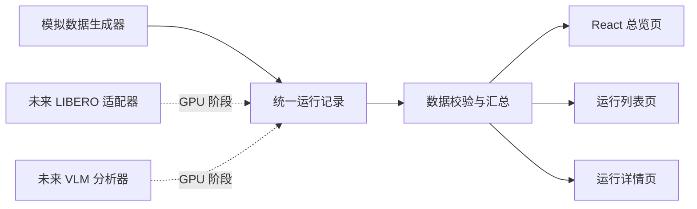

# ActionLens 项目实施计划

## 1. 项目定位

ActionLens 是一个面向机器人操作任务的仿真评测与视觉诊断平台。系统最终将使用 LIBERO 运行机器人操作任务，使用 SmolVLA 生成动作，使用 VLM 分析关键画面，并通过 React 页面展示每次运行的结果、视频和失败原因。

当前阶段不接入 GPU，不安装 CUDA，不下载或运行 SmolVLA、SmolVLM2 和 LIBERO。先在本地完成项目结构、数据协议、模拟评测数据、结果处理逻辑和 React 展示页面。之后租用 Linux GPU 服务器时，只需要补充真实评测适配器，并用真实运行结果替换模拟数据。

## 2. 当前阶段目标

无 GPU 阶段需要完成以下结果：

1. 建立可维护的前后端项目结构。
2. 确定单次机器人运行记录的数据格式。
3. 生成两个任务、两种条件下的模拟运行数据。
4. 实现结果汇总、筛选和失败分类逻辑。
5. 完成 React 总览页、运行列表页和运行详情页。
6. 为 VLA、LIBERO 和 VLM 预留清晰接口。
7. 编写本地启动、测试和数据替换说明。

本阶段完成后，即使没有 GPU，也应当能够演示完整的产品流程：

> 选择任务 → 查看统计结果 → 筛选成功或失败记录 → 打开单次运行 → 查看视频占位内容、关键帧、VLM 模拟诊断和人工复核结论

## 3. 当前阶段不做的内容

以下工作推迟到 GPU 阶段：

- 安装和运行 LIBERO 仿真环境；
- 下载和执行 `lerobot/smolvla_libero`；
- 运行 SmolVLM2 或其他视觉语言模型；
- 执行真实的 40 次机器人操作评测；
- 采集真实仿真视频和关键帧；
- 进行 CUDA、显存和推理速度优化；
- 训练或微调任何模型；
- 接入实体机器人。

为了避免误解，页面中的模拟结果必须显示“模拟数据”标识，不能将其作为真实模型实验结果使用。

## 4. 技术方案

### 4.1 本地开发技术栈

| 部分 | 方案 | 用途 |
|---|---|---|
| 前端 | React、TypeScript、Vite | 页面开发和交互 |
| 样式 | 原生 CSS 或 CSS Modules | 页面布局和状态样式 |
| 数据校验 | Zod | 校验导入的 JSON 数据 |
| 图表 | Recharts | 展示成功次数和条件对比 |
| 测试 | Vitest、React Testing Library | 数据逻辑和组件测试 |
| 数据处理 | Python 标准库 | 生成模拟记录和汇总数据 |
| 数据存储 | JSON | 保持简单并方便前端直接读取 |

当前版本不引入数据库和后端服务。React 直接读取构建后的 JSON 数据。只有在后续需要上传结果或多人协作时，才考虑增加 FastAPI 和数据库。

### 4.2 最终系统边界



模拟数据和未来真实数据必须使用同一份数据协议。这样接入 GPU 时不需要重写前端。

## 5. 建议目录结构

```text
actionlens/
├── PROJECT_PLAN.md
├── README.md
├── .gitignore
├── configs/
│   ├── tasks.json
│   └── evaluation.json
├── data/
│   ├── mock/
│   │   ├── runs.json
│   │   └── summary.json
│   └── real/
├── scripts/
│   ├── generate_mock_data.py
│   ├── validate_results.py
│   └── build_web_data.py
├── schemas/
│   ├── run.schema.json
│   └── diagnosis.schema.json
├── src/
│   ├── adapters/
│   │   ├── base_policy.py
│   │   ├── base_environment.py
│   │   └── base_diagnoser.py
│   └── evaluation/
│       ├── models.py
│       └── summary.py
├── web/
│   ├── public/
│   │   └── data/
│   └── src/
│       ├── components/
│       ├── pages/
│       ├── services/
│       ├── types/
│       └── styles/
├── tests/
└── docs/
    ├── data-format.md
    └── gpu-stage.md
```

## 6. 数据协议

### 6.1 单次运行记录

每次运行使用一个唯一的 `runId`，并至少包含以下字段：

```json
{
  "schemaVersion": "1.0",
  "runId": "task-a-normal-seed-0001",
  "dataSource": "mock",
  "task": {
    "id": "task-a",
    "name": "抓取并放置目标物体",
    "suite": "libero_object",
    "taskIndex": 0,
    "instruction": "Pick up the target object and place it in the container."
  },
  "condition": {
    "type": "normal",
    "perturbation": null
  },
  "seed": 1,
  "models": {
    "policy": "mock-policy",
    "diagnoser": "mock-vlm"
  },
  "result": {
    "status": "success",
    "success": true,
    "terminationReason": "environment_success",
    "executedSteps": 286,
    "maxSteps": 500,
    "durationSeconds": 46.2,
    "averageInferenceMs": null
  },
  "artifacts": {
    "videoUrl": null,
    "startFrameUrl": null,
    "middleFrameUrl": null,
    "endFrameUrl": null
  },
  "diagnosis": {
    "targetVisible": true,
    "targetPosition": "center-left",
    "taskStage": "completed",
    "suspectedFailureStage": null,
    "observations": ["目标物体已进入目标容器"],
    "needsHumanReview": false
  },
  "humanReview": {
    "reviewed": false,
    "failureCategory": null,
    "comment": null
  },
  "createdAt": "2026-11-24T10:00:00Z"
}
```

### 6.2 状态枚举

运行状态只允许使用：

- `success`：仿真器确认任务成功；
- `failed`：回合结束但未成功；
- `error`：环境、模型或文件处理异常；
- `interrupted`：运行被主动终止。

失败分类只允许使用：

- `target_recognition`：目标识别错误；
- `localization`：目标定位偏差；
- `grasp`：抓取失败；
- `placement`：放置失败；
- `control`：轨迹振荡或动作异常；
- `termination`：看似完成但环境未判定成功；
- `perturbation`：画面扰动导致明显退化；
- `system_error`：运行环境或文件处理异常；
- `unknown`：现有证据不足。

### 6.3 模拟数据规模

本地阶段生成 40 条模拟记录，以验证最终页面能承载正式实验数据：

| 任务 | 正常条件 | 扰动条件 | 合计 |
|---|---:|---:|---:|
| 任务 A | 10 | 10 | 20 |
| 任务 B | 10 | 10 | 20 |
| 总计 | 20 | 20 | 40 |

模拟数据应覆盖成功、失败、异常、缺少视频、缺少 VLM 诊断和需要人工复核等状态。数据生成时使用固定随机种子，保证每次生成的内容一致。

## 7. 页面功能

### 7.1 总览页

显示以下信息：

- 总运行次数；
- 成功、失败、异常和中断次数；
- 每个任务的成功次数和总次数；
- 正常条件与扰动条件对比；
- 平均运行时间；
- 成功回合的平均控制步数；
- 模拟数据警告；
- 典型失败记录入口。

统计结果统一显示为“成功次数/总次数”，例如 `7/10`，百分比只作为辅助信息。

### 7.2 运行列表页

支持以下筛选条件：

- 任务；
- 正常或扰动条件；
- 成功、失败、异常或中断；
- 随机种子；
- 是否有诊断结果；
- 是否需要人工复核。

列表需要支持清空筛选，并在没有匹配结果时显示明确的空状态。

### 7.3 运行详情页

展示以下内容：

- 任务名称和语言指令；
- 仿真条件与随机种子；
- 模型名称；
- 成功状态、终止原因、步数和耗时；
- 视频播放器或“视频尚未生成”提示；
- 开始、中间和结束关键帧；
- VLM 观察结果；
- 推测的失败阶段；
- 人工复核结论；
- 数据来源标识。

### 7.4 错误和空状态

页面必须处理：

- JSON 加载失败；
- 数据格式校验失败；
- 筛选结果为空；
- 视频文件缺失；
- 关键帧缺失；
- VLM 诊断缺失；
- 未完成人工复核；
- 单次运行发生系统错误。

## 8. 开发阶段与验收标准

### 阶段 1：项目骨架与规范

状态：已完成（2026-11-24）。

工作内容：

- 初始化 Git 仓库基础文件；
- 初始化 React、TypeScript 和 Vite；
- 建立 Python 脚本和数据目录；
- 编写任务配置和数据 Schema；
- 设置基础测试命令。

完成标志：

- 前端可以本地启动；
- Python 数据脚本可以运行；
- README 包含统一的启动命令；
- 无需 CUDA 和 GPU。

### 阶段 2：模拟数据与统计逻辑

状态：已完成（2026-11-24）。

工作内容：

- 生成 40 条固定模拟记录；
- 校验必填字段和枚举值；
- 计算任务、条件和状态统计；
- 构造缺失视频、诊断失败等边界数据；
- 为统计函数编写测试。

完成标志：

- 相同命令始终生成相同结果；
- 非法数据能够被拒绝并指出字段；
- 汇总数据与原始记录数量一致；
- 成功次数不把 `error` 误算成普通失败。

### 阶段 3：React 核心页面

状态：已完成（2026-11-24）。

工作内容：

- 实现总览卡片和任务对比图；
- 实现运行记录表格；
- 实现组合筛选；
- 实现详情页；
- 实现加载、错误和空状态。

完成标志：

- 可以从总览进入单次运行详情；
- 多个筛选条件可以同时生效；
- 页面刷新后仍能通过 URL 打开指定记录；
- 不存在视频时页面不会崩溃；
- 手机和常用桌面宽度下没有明显溢出。

### 阶段 4：接口占位与文档

状态：已完成（2026-11-24）。

工作内容：

- 定义环境、策略和诊断器抽象接口；
- 编写真实结果导入脚本；
- 说明真实视频和关键帧的目录约定；
- 编写 GPU 阶段接入清单；
- 完成本地演示说明。

完成标志：

- 模拟数据可以通过一个配置项替换为真实数据；
- 前端不依赖 SmolVLA 或 LIBERO 的内部格式；
- GPU 阶段需要实现的接口和命令已有明确位置；
- 新用户按照 README 可以启动页面。

## 9. 建议时间安排

| 日期顺序 | 工作 | 预计用时 |
|---|---|---:|
| 第 1 天 | 初始化项目、确定 Schema 和任务配置 | 3～5 小时 |
| 第 2 天 | 模拟数据生成、校验和汇总逻辑 | 4～6 小时 |
| 第 3 天 | React 总览页和运行列表页 | 5～7 小时 |
| 第 4 天 | 详情页、筛选和错误状态 | 5～7 小时 |
| 第 5 天 | 测试、文档和 GPU 接口占位 | 4～6 小时 |

如果采用业余时间开发，可以将上述工作分散到 1～2 周完成。

## 10. 无 GPU 阶段验收清单

- [x] 项目能在 Windows 本地启动；
- [x] 不要求安装 CUDA、MuJoCo 或 LIBERO；
- [x] 可以生成并校验 40 条模拟运行记录；
- [x] 页面明确标识模拟数据；
- [x] 总览页显示成功次数和总次数；
- [x] 可以按任务、条件和状态筛选；
- [x] 可以打开任意运行详情；
- [x] 缺少视频和诊断时有明确提示；
- [x] 至少包含 3 条不同类型的模拟失败案例；
- [x] 数据和页面核心逻辑具有自动化测试；
- [x] README 说明安装、启动、测试和数据生成方法；
- [x] GPU 阶段的接口和待办事项已记录。

## 11. GPU 阶段进入条件

满足以下条件后再租用 GPU：

1. 本地页面能够完整展示 40 条模拟记录；
2. 数据 Schema 不再频繁变化；
3. 已确定两个 LIBERO 任务的候选范围；
4. 已准备单回合测试命令和结果目录；
5. 已实现单次运行结果导入和校验；
6. 已制定云端文件备份方法。

GPU 阶段的第一目标不是直接完成 40 次评测，而是跑通一个任务、一个随机种子和一个完整视频。单回合验证通过后，再依次完成 4 次小规模测试和正式 40 次运行。

## 12. 当前第一批任务

按以下顺序开始实施：

1. 初始化 React、TypeScript 和 Vite；
2. 建立 `run.schema.json`；
3. 编写 `generate_mock_data.py`；
4. 生成 40 条模拟数据；
5. 实现总览页；
6. 实现运行列表和筛选；
7. 实现运行详情页；
8. 补充测试和 README。

在上述任务完成前，不进行 GPU 租用、CUDA 配置或模型下载。
