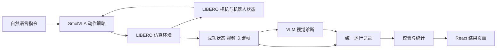

# ActionLens

ActionLens 是一个面向具身智能机器人操作的仿真评测与视觉诊断平台。系统计划在 LIBERO 中执行自然语言操作指令，使用 SmolVLA 生成动作、使用 VLM 分析关键画面，并通过 React 页面展示每次运行的视频、成功状态和失败原因。

当前已完成无 GPU 阶段：数据生成、Schema 校验、统计、结果浏览、真实结果导入和前端数据切换均可运行。LIBERO、SmolVLA 和 VLM 的真实评测将在 GPU 阶段接入。

> **数据说明：** 仓库当前附带的 40 条记录全部是用于开发页面和测试流程的固定模拟数据，不代表 SmolVLA 的真实表现。页面始终显示当前数据来源；真实任务成功状态只能由 LIBERO 仿真环境判定。

## 项目架构



## 实施状态

| 阶段 | 内容 | 状态 |
|---|---|---|
| 1 | 项目骨架、数据协议和适配器接口 | 已完成 |
| 2 | 40 条模拟记录、Schema 校验和统计 | 已完成 |
| 3 | React 总览、组合筛选和运行详情 | 已完成 |
| 4 | 真实结果导入、媒体约定和接入文档 | 已完成 |
| 5 | LIBERO、SmolVLA、VLM 和真实 40 次评测 | 待进行 |

## 当前能力

- 生成两个任务、两种画面条件下共 40 条固定模拟记录；
- 使用 JSON Schema 和语义规则校验运行数据；
- 统计成功、失败、异常、中断、耗时和控制步数；
- 按任务、条件、状态、种子和诊断状态筛选；
- 通过 URL 直接打开单次运行详情；
- 展示视频、关键帧、VLM 诊断和人工复核的存在或缺失状态；
- 导入云端产生的真实记录和媒体文件；
- 在模拟数据和真实数据之间切换。

## 技术栈

| 模块 | 技术 |
|---|---|
| 仿真与控制 | LIBERO、LeRobot、SmolVLA，GPU 阶段接入 |
| 视觉诊断 | SmolVLM2 或兼容 VLM，GPU 阶段接入 |
| 数据处理 | Python、JSON Schema、结构化 JSON |
| 前端 | React、TypeScript、Vite、Zod |
| 测试 | Python unittest、Vitest、React Testing Library |

## 快速启动

首次运行，在项目根目录执行：

```powershell
git clone https://github.com/szexiaoming/ActionLens.git
cd ActionLens
python -m venv .venv
.\.venv\Scripts\python.exe -m pip install -e .
cd web
npm install
npm run dev
```

浏览器打开 `http://localhost:5173`。

Linux 或 macOS 使用：

```bash
git clone https://github.com/szexiaoming/ActionLens.git
cd ActionLens
python3 -m venv .venv
./.venv/bin/python -m pip install -e .
cd web
npm install
npm run dev
```

后续启动只需要：

```powershell
cd web
npm run dev
```

## 生成模拟数据

在项目根目录执行：

```powershell
.\.venv\Scripts\python.exe scripts\generate_mock_data.py
.\.venv\Scripts\python.exe scripts\validate_results.py
```

输出文件：

- `data/mock/runs.json`：40 条模拟运行记录；
- `data/mock/summary.json`：模拟数据汇总；
- `web/public/data/`：当前提供给 React 的数据和数据清单。

## 选择网页数据来源

切换到模拟数据：

```powershell
.\.venv\Scripts\python.exe scripts\build_web_data.py --source mock
```

导入真实数据后，切换到真实数据：

```powershell
.\.venv\Scripts\python.exe scripts\build_web_data.py --source real
```

前端先读取 `web/public/data/manifest.json`，再加载清单指定的运行记录和汇总文件。页面不会直接读取 LIBERO、LeRobot 或 PyTorch 对象。

## 导入真实结果

云端结果可以是一个 `runs.json`，也可以是包含多个 `metadata.json` 的目录：

```powershell
.\.venv\Scripts\python.exe scripts\import_real_results.py incoming\libero-evaluation
```

导入器会：

1. 检查每条记录是否标记为 `dataSource: "real"`；
2. 校验 JSON Schema 和跨字段规则；
3. 拒绝绝对路径、远程 URL 和越过导入目录的媒体路径；
4. 将视频和关键帧复制到 `web/public/media/<run-id>/`；
5. 生成 `data/real/runs.json` 和 `summary.json`；
6. 将前端数据来源切换为真实数据。

完整输入格式见 [真实结果导入说明](docs/result-import.md)，媒体目录见 [媒体文件约定](docs/media-layout.md)。

## 页面路由

- `#/`：实验总览和运行记录；
- `#/runs`：定位到运行记录区域；
- `#/runs/<run-id>`：可刷新、可直接打开的单次运行详情。

## 检查与测试

在项目根目录执行 Python 测试：

```powershell
.\.venv\Scripts\python.exe -m unittest discover -s tests -v
```

在 `web` 目录执行前端检查：

```powershell
npm run check
npm run test
npm run build
```

## 目录说明

```text
configs/           任务和评测配置
data/mock/         固定模拟记录
data/real/         导入后的真实记录和汇总
docs/              数据、媒体、演示和 GPU 接入说明
schemas/           运行记录与诊断 JSON Schema
scripts/           生成、校验、导入和数据切换命令
src/actionlens/    Python 接口及评测数据逻辑
tests/             Python 自动化测试
web/               React 前端
web/public/media/  导入后供网页读取的媒体文件
```

## 项目边界

- 任务成功只由仿真环境判定；
- VLM 只提供视觉观察和辅助诊断；
- 模拟数据只用于开发页面和验证流程；
- 当前版本不训练模型，不连接实体机器人；
- GPU 阶段开始前不会安装 CUDA、LIBERO 或模型权重。

项目实施计划见 [PROJECT_PLAN.md](PROJECT_PLAN.md)。本地演示步骤见 [本地演示说明](docs/local-demo.md)，下一阶段准备工作见 [GPU 阶段接入清单](docs/gpu-stage.md)。
